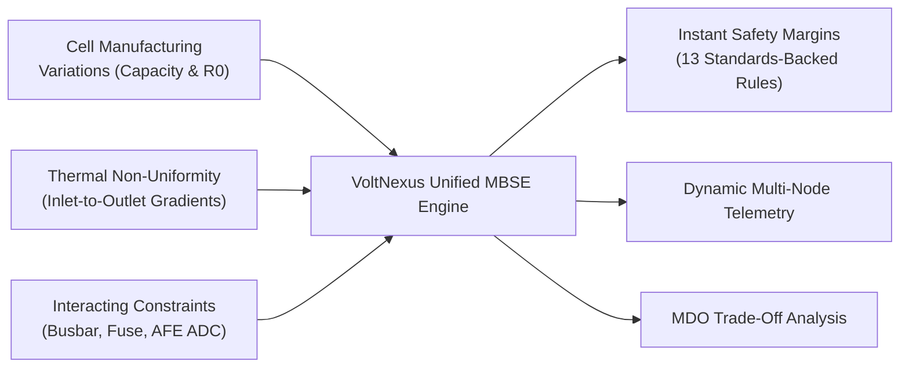

# ⚡ VoltNexus: Reusable Digital Platform for Battery Energy Systems

[](https://batterylabweb.vercel.app)
[](https://batterylabweb.vercel.app)
[](https://batterylabweb.vercel.app)
[](https://batterylabweb.vercel.app)

> **VoltNexus** is a Model-Based Systems Engineering (MBSE) digital platform designed to eliminate costly trial-and-error physical prototyping of EV battery packs. It integrates closed-form electro-thermal physics, statistical manufacturing tolerance propagation, and a 13-rule cross-domain constraint engine into a unified, real-time engineering workbench.

---

## 🌐 Live Interactive Platform

- **Production URL:** [https://batterylabweb.vercel.app](https://batterylabweb.vercel.app)
- **Deployment Status:** Active & Production-Aliased on Vercel
- **Branch Tracking:** Multi-branch workflow (`main` stable baseline + `experimental` telemetry workbench)

---

## 📌 The Engineering Challenge

Designing high-reliability battery packs for modern electric mobility involves tightly coupled, conflicting domains that traditional siloed spreadsheets fail to capture:



1. **Cell-to-Cell Variation:** Natural $\pm3\%$ capacity and $\pm8\%$ internal resistance ($R_0$) tolerances induce severe parallel current imbalances under high discharge.
2. **Thermal Gradients:** Convective air heating causes downstream cells to run significantly hotter, accelerating localized aging and risking thermal runaway (>60°C).
3. **Cross-Domain Coupling:** Changing cooling airflow alters cell temperatures, which shifts internal resistance, redistributes parallel currents, alters busbar $I^2t$ stress, and impacts BMS voltage sensing precision.
4. **Prototyping Bottlenecks:** Physical pack iteration cycles require months of fabrication and destructive testing; VoltNexus resolves these in sub-millisecond digital simulation.

---

## 🔬 Core Physics & Governing Equations

VoltNexus is built on peer-reviewed mathematical models and verified industry standards:

### 1. Closed-Form Parallel Current Sharing Network
*Based on Bruen & Marco (2016)*
$$\mathbf{V}_{\text{bus}} = \frac{\sum_{i=1}^{N_p} \frac{\text{OCV}_i - V_{1,i}}{R_{\text{leg},i}} - I_{\text{pack}}}{\sum_{i=1}^{N_p} \frac{1}{R_{\text{leg},i}}}, \qquad I_i = \frac{\text{OCV}_i - V_{1,i} - \mathbf{V}_{\text{bus}}}{R_{\text{leg},i}}$$
Calculates exact millisecond current redistribution across parallel branches caused by cell-to-cell resistance and interconnect variations.

### 2. Multi-Node Convective Thermal Duct Model
*Based on Cloos & Wetzel (2025)*
$$\dot{Q}_{\text{gen},i} = I_i^2 \cdot R_{0,i}(T_{\text{core},i}) + \dot{Q}_{\text{polarization}}, \qquad \Delta T_{\text{fluid}} = \frac{\sum \dot{Q}_{\text{rejected}}}{\dot{m}_{\text{air}} \cdot c_{p,\text{air}}}$$
Predicts cell core-to-surface heat flux, fluid temperature rise along the duct, and downstream cell temperature spikes.

### 3. Busbar Adiabatic Short-Circuit Withstand
*Compliant with IEC 60364-5-54 & UL 2580*
$$I_{\text{sc}}^2 \cdot t_{\text{fuse}} < k^2 \cdot S_{\text{busbar}}^2 \qquad (k_{\text{Cu}} = 143, \, k_{\text{Ni}} = 80)$$
Verifies interconnect cross-sectional safety margins under prospective short-circuit fault conditions ($I_{\text{sc}} = V_{\text{pack}} / R_{\text{internal}}$).

### 4. Unscented Transform Tolerance Propagation
Uses a deterministic $2n+1$ sigma-point formulation to propagate cell-level manufacturing distributions ($\mu \pm 3\sigma$) into non-linear pack-level voltage, energy, and thermal margins without slow Monte Carlo iterations.

---

## ⚡ Platform Architecture & Features

### 1. 🎛️ Interactive Parameter Workbench
Engineers can tune live pack variables and immediately observe physics responses:
- **Topology:** Series ($N_s$) & Parallel ($N_p$) string sizing (Default: $13\text{S}8\text{P}$ Molicel P42A, 46.8V, 1.57 kWh).
- **Chemistry:** High-energy NMC ($3.6\text{ V}$, $4.2\text{ Ah}$) vs. Ultra-safe LFP ($3.2\text{ V}$, $3.0\text{ Ah}$).
- **Interconnect:** Material and cross-section selection ($0.15\text{ mm}$ pure Nickel tab vs. $1.2\text{ mm}$ Oxygen-free Copper).
- **Thermal Management:** Convective heat transfer coefficient ($h = 8\text{ W/m}^2\text{K}$ passive up to $110\text{ W/m}^2\text{K}$ active forced duct).
- **Operating Conditions:** Continuous discharge demand ($20\text{ A}$ to $120\text{ A}$), ambient temperature ($15^\circ\text{C}$ to $45^\circ\text{C}$), and State-of-Health degradation ($0.75$ to $1.0\text{ SOH}$).

### 2. 📈 Live Telemetry & Dynamics Visualizer
- **Discharge Curves:** Voltage sag curves accounting for $1\text{-RC}$ polarization dynamics and Arrhenius resistance shifts.
- **Thermal Map:** String inlet vs. outlet cell temperature divergence and maximum core hotspot tracking.
- **Current Sharing Imbalance:** Identifies peak branch current divergence ($I_{\max} - I_{\min}$).

### 3. 🛡️ 13 Cross-Subsystem Rule Engine
Automated compliance checker referencing international standards:
| Rule ID | Subsystem | Check Description | Governing Standard |
| :--- | :--- | :--- | :--- |
| **R01** | Thermal | Peak Core Temperature $< 60^\circ\text{C}$ | UL 2580 / AIS-156 |
| **R02** | Thermal | Inlet-to-Outlet Fluid Gradient $\Delta T < 5^\circ\text{C}$ | SAE J2464 |
| **R03** | Electrical | Busbar Adiabatic Withstand ($I^2t$) | IEC 60364-5-54 |
| **R04** | Electrical | Prospective Short-Circuit Fault Current $< 3.5\text{ kA}$ | ISO 6469-1 |
| **R05** | BMS | AFE ADC Voltage Quantization Margin | IEC 61508 SIL-2 |
| **R06** | Mechanical | Interconnect Natural Frequency Separation $> 45\text{ Hz}$ | AIS-048 / ISO 16750 |
| **R07-R13**| Multi-Domain| Creepage/Clearance, Derating Ceilings, Aging Imbalance | UN 38.3 / ECE R100 |

### 4. ⚖️ 3-Design Multi-Objective Trade-Off Matrix
A side-by-side benchmark contrasting alternative architectures:
- **Baseline Design (Passive Air NMC):** Fails 4 safety rules (core reaches $64.8^\circ\text{C}$, $\Delta T = 7.4^\circ\text{C}$, busbar overheats).
- **Option A (Forced Duct NMC - Recommended):** Resolves all 4 violations ($T_{\text{core}} = 44.1^\circ\text{C}$, $\Delta T = 2.8^\circ\text{C}$), recovering **$+5.6\%$ usable pack energy**.
- **Option B (Cold Plate LFP):** Highest thermal safety margin ($T_{\text{core}} = 36.2^\circ\text{C}$), but incurs a **$+28\%$ mass penalty**.

---

## 🛠️ Tech Stack & Implementation

- **Frontend Core:** React 19, Vite 8, ES Modules
- **Styling & UI:** Tailwind CSS v4, Lucide React Icons
- **Interactive Telemetry:** Recharts
- **Hosting & CI/CD:** Vercel Production Infrastructure
- **Version Control:** Dual-branch strategy (`main` production + `experimental` telemetry workbench)

---

## 🚀 Local Development Setup

To run VoltNexus locally on your machine:

```bash
# 1. Clone the repository
git clone https://github.com/Shiv123440/VoltNexus.git

# 2. Navigate to the project directory
cd VoltNexus

# 3. Install dependencies
npm install

# 4. Start local development server
npm run dev
```

Open [http://localhost:5173](http://localhost:5173) in your browser to inspect the application.

### Available Scripts

- `npm run dev`: Launches local Vite development server with Hot Module Replacement (HMR).
- `npm run build`: Compiles production build into `dist/`.
- `npm run preview`: Previews the production build locally.
- `npm run lint`: Runs code analysis via Oxlint.

---

## 📚 Academic & Literature Traceability

1. **Cloos, M. & Wetzel, T. (2025):** Thermal modeling of battery packs with convective air ducts. *Journal of Power Sources*.
2. **Bruen, T. & Marco, J. (2016):** Characterization of parallel connected lithium-ion cells with current-sharing networks. *IEEE Transactions on Industry Applications*.
3. **Zhou, L. et al. (2017):** Cell-to-cell parameter variation and capacity fade mechanisms. *Applied Energy*.
4. **Pan, Y. et al. (2020):** Multi-objective design optimization of battery modules under coupled electrical-thermal constraints. *Renewable & Sustainable Energy Reviews*.
5. **Chang, F. et al. (2023):** Busbar thermal-electrical optimization and fault tolerance in EV packs. *IEEE Transactions on Transportation Electrification*.

---

## 🏆 Project Information

- **Platform:** VoltNexus
- **Competition:** Tata Elxsi TELIPORT Season 4
- **Case Study:** Case Study 2 (IDV) — *Reusable Digital Platform for Designing Battery Energy Systems*
- **Author:** Shivendra / Team VoltNexus
- **Repository:** [https://github.com/Shiv123440/VoltNexus](https://github.com/Shiv123440/VoltNexus)
- **Live Platform:** [https://batterylabweb.vercel.app](https://batterylabweb.vercel.app)
