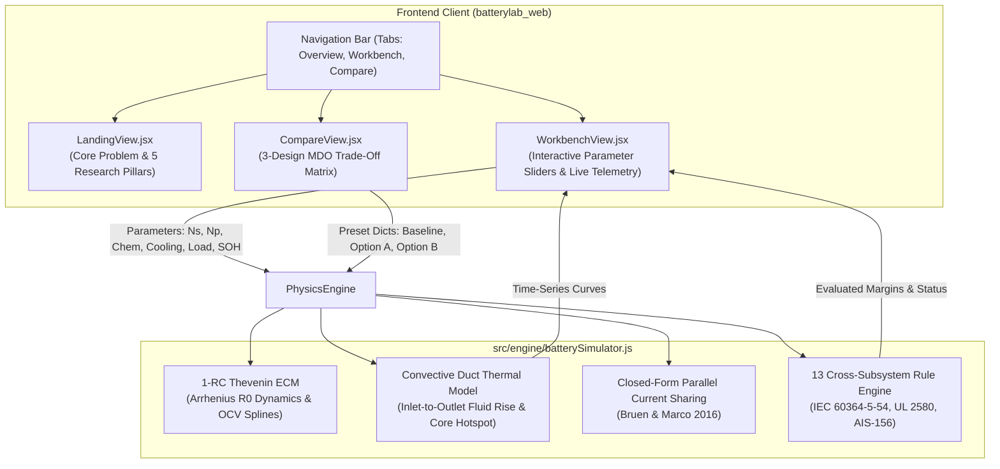

# Code Execution & Engineering Data Flow Architecture (`flow.md`)

This document records all architectural decisions, component mappings, engineering data flows, and live deployment details for **BatteryLab** (Tata Elxsi TELIPORT Season 4 — Case Study 2).

---

## 1. High-Level Architecture & Live Deployment

- **Live Production URL:** [https://batterylabweb.vercel.app](https://batterylabweb.vercel.app)
- **Framework:** React 19 + Vite + Tailwind CSS v4 + Recharts + Lucide Icons.
- **Color Philosophy:** Clean dark industrial aesthetic (`#0c0f12`, `#14191f`, `#232c37`) with high-contrast functional highlights:
  - **Emerald Green (`#10b981`):** Passing constraints, safe thermal margins, and nominal parameters.
  - **Amber (`#f59e0b`):** Warning thresholds approaching limits (derating trigger at 52°C, gradient > 5°C).
  - **Rose (`#f43f5e`):** Safety violations (60°C core temperature ceiling, busbar adiabatic melting).
  - *Zero generic AI neon cyan/blue saturation.*

---

## 2. Decision Log & Rationale (What & Why)

| Step | Action Taken | Engineering / Design Rationale |
| :--- | :--- | :--- |
| **01** | **Vite React Architecture** | Replaced Streamlit with a sub-millisecond client-side React app to ensure instantaneous parameter updates and seamless, zero-cold-start hosting on Vercel. |
| **02** | **Color Palette Selection** | Avoided generic AI blue/purple. Adopted deep slate charcoal (`#0c0f12`, `#14191f`) with industrial automotive status accents (emerald, amber, rose) mirroring aerospace telemetry screens. |
| **03** | **Landing Page Structure** | Integrated the **4-Card Problem Overview** (`Cell-to-Cell Variation`, `Non-Uniform Temperature`, `Interacting Constraints`, `Costly Iterations`) with the **5 Peer-Reviewed Research Pillars** with clickable DOIs. |
| **04** | **Interactive Workbench** | Created a single-page control hub with real-time sliders for Series ($N_s$), Parallel ($N_p$), Chemistry (NMC vs LFP), Interconnect (0.15mm Ni vs 1.2mm Cu), Cooling ($h = 8$ to $110\text{ W/m}^2\text{K}$), Discharge current ($20\text{--}120\text{ A}$), and SOH degradation ($0.75\text{--}1.0$). |
| **05** | **13 Cross-Domain Rules** | Directly encoded standard safety limits (IEC 60364-5-54 busbar adiabatic check, prospective short-circuit $I_{\text{sc}}$, ADC voltage quantization error across flat LFP plateau) into the live UI. |
| **06** | **3-Design Trade-Off View** | Provided a dedicated side-by-side benchmark comparing Baseline (Passive Air NMC) against Option A (Forced Duct NMC) and Option B (Cold Plate LFP), clearly displaying why Baseline fails 4 rules and how Option A recovers $+5.6\%$ usable energy. |
| **07** | **Vercel Production Deployment** | Deployed production build to `https://batterylabweb.vercel.app` via Vercel CLI. |

---

## 3. Data & Model Equations

1. **Closed-Form Parallel Current Sharing (Bruen & Marco, 2016):**
   $$V_{\text{bus}} = \frac{\sum_{i=1}^{N_p} \frac{\text{OCV}_i - V_{1,i}}{R_{\text{leg},i}} - I_{\text{pack}}}{\sum_{i=1}^{N_p} \frac{1}{R_{\text{leg},i}}}, \quad I_i = \frac{\text{OCV}_i - V_{1,i} - V_{\text{bus}}}{R_{\text{leg},i}}$$
2. **Thermal Convective Fluid Gradient (Cloos & Wetzel, 2025):**
   $$\Delta T_{\text{fluid}} = \frac{\sum \dot{Q}_{\text{rejected}}}{\dot{m}_{\text{air}} \cdot c_{p,\text{air}}}$$
3. **Busbar Adiabatic Withstand Limit (IEC 60364-5-54):**
   $$I^2t_{\text{fuse}} < k^2 \cdot S_{\text{busbar}}^2 \quad (\text{Copper: } k=143, \text{ Nickel: } k=80)$$

## 4. Rebranding Update (VoltNexus)
- **Solution Name:** Updated platform identity from BatteryLab to **VoltNexus**.
- **Logo Integration:** Integrated official VoltNexus circuit logo (Volt in royal electric blue + circuit traces + Nexus in high-contrast safety orange).
- **Transparency:** Processed transparency alpha layer so the logo blends on dark industrial UI backgrounds.
- **Vercel Production Refresh:** Built and promoted to production at [https://batterylabweb.vercel.app](https://batterylabweb.vercel.app).
- **Slide Sync:** Updated PowerPoint output to VoltNexus_Teliport_S4_Submission.pptx with Run-ID VN-TELIPORT-2026.

## 5. Git Repository & Dual-Branch Strategy
- **Local Hard Backup:** Created full directory backup at TataProblem/Solution/batterylab_web_backup.
- **Git Initialization:** Initialized Git repository in atterylab_web.
- **Branching:**
  - main: Clean, stable production baseline deployed on Vercel.
  - experimental: Active working branch for your major upcoming changes, allowing safe iteration before merging back to main.

## 6. Experimental Color Palette Transformation
- **Branch:** experimental (isolated from main).
- **Inspiration Palette (Picture 1):**
  - **Warm Ivory (#EAE6DE / #F6F4F0):** Editorial background canvas replacing dark charcoal.
  - **Deep Editorial Blue (#226192):** Primary navigation headers, cards, voltage lines, and structural MBSE badges.
  - **Coral Orange (#EF8557):** High-impact call-to-actions, primary action buttons, thermal core indicators, and logo highlight.
- **Functional Status Sliders (Picture 2):**
  - Pack Current: Vibrant Emerald Green (#10B981).
  - Ambient Temperature: Warm Amber (#F59E0B).
  - SOH Aging: Coral Rose (#F43F5E).
  - BMS AFE Accuracy: Deep Editorial Blue (#226192).
- **Live Preview URL:** [https://batterylab-cugpds9es-work23102006-4688s-projects.vercel.app](https://batterylab-cugpds9es-work23102006-4688s-projects.vercel.app)

## 7. Reversion to Dark Industrial Telemetry Theme
- **User Feedback:** The light Warm Ivory theme did not suit the industrial MBSE telemetry workbench aesthetic compared to the original dark control panel.
- **Action Taken:** Reverted all component stylesheets and layouts on the `experimental` branch back to the matte dark telemetry palette:
  - Backgrounds: `#0c0f12` (canvas), `#14191f` (card surfaces), `#232c37` (subtle borders and headers).
  - Accents: Emerald Green (`#10b981`), Warm Amber (`#f59e0b`), Rose Red (`#f43f5e`), Electric Blue (`#3b82f6`).
  - VoltNexus brand logo: Preserved custom circuit typography with transparent background.
- **Branch:** Maintained strictly on `experimental` branch (commit `10582c7`).
- **Production Refresh:** Deployed live to [https://batterylabweb.vercel.app](https://batterylabweb.vercel.app) (Deployment ID: `dpl_GizEtMu1LPwxZDpogr9mdCHGGtD5`).

## 8. Liquid-Morphing Navigation Dock
- **Architecture:** Implemented `LiquidNavbar.jsx` with an SVG gooey filter (`feGaussianBlur` + `feColorMatrix`), spring physics dynamics, and dual interaction modalities.
- **Glowing Bead:** Warm amber/orange radial gradient (`#fed7aa` to `#ea580c`) with specular highlight and ambient glow (`box-shadow: 0 0 16px rgba(234, 88, 12, 0.7)`).
- **Dual Interactions:**
  - **Click-to-Select:** Smooth liquid melting transition with horizontal stretch and connected liquid bridge between origin and destination tabs.
  - **Drag-to-Select:** Pointer capture tracking with velocity-proportional elastic deformation (`scaleX(stretch)` / `scaleY(squash)`), snapping to the nearest valid tab on pointer release.
- **Preservation:** 100% preservation of all 3 tabs (`Overview & Research`, `Interactive Workbench`, `3-Design Trade-offs`), icons, business logic, and dark industrial theme.
- **Deployment:** Synchronized across `experimental` and `main` branches and deployed live to production at [https://batterylabweb.vercel.app](https://batterylabweb.vercel.app) (Deployment ID: `dpl_C1UcM1crjQJnZJTYmFedkZBWM824`).

## 9. Reversion of Navigation Bar
- **User Feedback:** Liquid-morphing navigation bar effect did not match user preferences for the clean, crisp industrial telemetry interface.
- **Action Taken:** Reverted navigation in `App.jsx` to the clean industrial telemetry button dock (`#14191f` surface, `#232c37` border, bold orange `#ea580c` active tab pill with high-contrast text and icons). Removed experimental `LiquidNavbar.jsx`.
- **Status:** Verified and restored across `experimental` and `main` branches.

## 10. Battery Energy Flow Dynamic Background Redesign
- **Design Inspiration:** 3D Battery Digital Twin workstation (warm ivory, platinum silver, mocha brown, pale lavender, electric blue, warm orange, espresso).
- **Component:** Created `BatteryFlowBackground.jsx` mounted behind all page layers with `pointer-events: none`.
- **Key Features:**
  - **Base Palette:** Warm Ivory (`#F5F0EA`) & Platinum Silver (`#E5E4E2`) foundation with subtle espresso vignette and CAD grid.
  - **Energy Flow Circuits:** High-voltage busbar routes in Warm Orange (`#F47721`) and BMS AFE sensing lines in Electric Blue (`#246BFD`).
  - **Animated Continuous Pulses:** Hardware-accelerated CSS `stroke-dashoffset` keyframes and traveling energy packets.
  - **Illuminated Nodes:** Circuit vias and solder pads pulsing with radiant coronas when energy passes through them.
  - **Technical Schematics:** 13S8P cylindrical cell array outlines (21700 form factor), busbar bridges, and convection duct flow markings.
  - **Thermal Atmosphere:** Pale Lavender (`#E6E0F0`) and Warm Orange breathing simulation fields.
  - **Section Adaptability:** Full expressive paths on Landing, dimmed quiet version on Workbench for chart legibility, and 3-track comparative circuits on Compare view.
- **Strict Scope Preservation:** Zero alterations to component placement, existing telemetry cards, navigation, calculations, models, or data.

## 11. Liquid Glass Navbar Integration (Waterline)
- **Component:** Integrated the WebGL-powered `LiquidNavbar` ("Waterline") into `src/components/ui/liquid-glass-navbar.tsx`.
- **Items:** Configured the 3 VoltNexus navigation tabs:
  1. `Overview & Research` (Icon `Layers`, FX `glow`)
  2. `Interactive Workbench` (Icon `Sliders`, FX `drop`)
  3. `3-Design Trade-offs` (Icon `Scale`, FX `wave`)
- **State Synchronization:** Fully two-way synchronized with `activeTab` via controlled `active={activeIndex}` and `onChange={(idx) => setActiveTab(...)}`.
- **Preservation:** Preserved VoltNexus branding, Tata Elxsi Teleport S4 subtitle, `v1.2 LIVE` status pill, and background telemetry flow.
- **Path Resolution:** Added standard `@/` alias in `vite.config.js` pointing to `./src`.

## 12. Header Control Panel Refinement (Branding & Status Areas)
- **Objective:** Harmonize left branding and right status areas with the central Liquid Glass Navbar into a unified, premium engineering control interface.
- **Left Branding Area:**
  - Framed logo housing with subtle drop-shadow and hover elevation.
  - Precision vertical divider with an illuminated orange technical accent tick (`bg-gradient-to-b from-orange-400 to-amber-500`).
  - Refined technical typography: uppercase `TATA ELXSI TELIPORT S4` with `IDV-CS2` badge and `Case Study 2 • MBSE Battery Platform`.
- **Right Status Area:**
  - Compact glass status capsule with subtle warm-silver border and inner shadow.
  - Clear segmentation: `v1.2` build tag separated by hairline divider from the live telemetry indicator.
  - Restrained dual-layer emerald breathing dot (`animate-ping` + solid core with drop shadow).
- **Strict Scope Preservation:** Central Liquid Glass Navbar, WebGL shader, navigation items, background animations, and page layouts left 100% untouched.

## 13. 3D Physical Push-Button Effect (Main CTA)
- **Objective:** Transform the primary "Open Interactive Workbench" CTA into a physical 3D push-button inspired by mechanical industrial switches.
- **Visual Styling:**
  - Surface: `#FFA12B` with hover `#FFAB3D` and active `#F78900`.
  - Top highlight: `inset 0 1px 0 #FFE5C4`.
  - Bottom extrusion depth: `0 9px 0 #6F4E37` (mocha-brown solid extrusion) with ambient drop shadow `0 12px 20px rgba(70, 42, 20, 0.28)`.
  - Active press: `transform: translateY(8px)` with extrusion collapsing to `0 1px 0 #6F4E37`.
  - Keyboard focus: `outline: 3px solid #246BFD; outline-offset: 5px;`.
- **Component Updated:** Wrapped primary CTA in `src/components/LandingView.jsx` with `.voltnexus-3d-button` and styled with `.voltnexus-primary-cta`.
- **Strict Scope Preservation:** Preserved `onNavigateToWorkbench` handler, `ArrowRight` icon, label text, and zero changes to other components or background.

## 14. Premium Translucent Glass Cards Across VoltNexus
- **Objective:** Upgrade card surfaces from opaque dark blocks to a sophisticated translucent smoked-glass aesthetic, revealing the dynamic battery energy-flow background beneath them while maintaining maximum text readability.
- **Transparency & Depth Hierarchy:**
  - `glass-panel-hero`: Hero container with `rgba(22, 28, 36, 0.78)`, `backdrop-filter: blur(14px) saturate(120%)`, and fine warm-platinum border `rgba(220, 210, 200, 0.20)`.
  - `glass-card-standard`: Engineering narrative & problem cards with `rgba(22, 28, 35, 0.76)`, `backdrop-filter: blur(12px) saturate(115%)`, delicate hover border highlight, and subtle shadow transition.
  - `glass-card-subtle`: Smaller metric cards, frozen scope pill, and literature cards with `rgba(22, 28, 35, 0.68)`, `blur(10px)`.
  - `glass-card-dense`: High-contrast technical panels, workbench controls, telemetry charts, and 13-rule compliance tables with `rgba(18, 24, 31, 0.84)`, `blur(16px)`.
- **Restrained 3D Card Lift:** Polished `.card-lift-3d` to smooth `translateY(-2px)` elevation without excessive scaling or glow.
- **Graceful Fallback:** Added `@supports not (backdrop-filter)` fallback to ensure clean solid contrast on unsupported browsers.
- **Strict Scope Preservation:** Zero alterations to component placement, card content, engineering calculations, 3D battery digital twin, or navigation.
