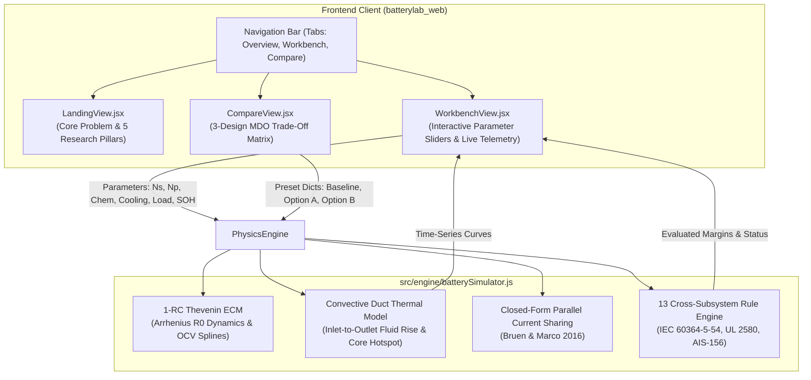

# Code Execution & Engineering Data Flow Architecture (`flow.md`)

This document records all architectural decisions, component mappings, engineering data flows, and live deployment details for **BatteryLab** (Tata Elxsi TELIPORT Season 4 — Case Study 2).

---

## 1. High-Level Architecture & Live Deployment

- **Live Production URL:** [https://batterylabweb.vercel.app](https://batterylabweb.vercel.app)
- **Framework:** React 19 + Vite + Tailwind CSS v4 + Recharts + Lucide Icons.
- **Color Philosophy:** Clean dark industrial aesthetic (`#0c0f12`, `#14191f`, `#232c37`) with high-contrast functional highlights:
  - **Emerald Green (`#10b981`):** Passing constraints, safe thermal margins, and nominal parameters.
  - **Amber (`#f59e0b`):** Warning thresholds approaching limits (derating trigger at 52°C, gradient > 5°C).
  - **Rose (`#f43f5e`):** Safety violations (60°C core temperature ceiling, busbar adiabatic melting).
  - *Zero generic AI neon cyan/blue saturation.*

---

## 2. Decision Log & Rationale (What & Why)

| Step | Action Taken | Engineering / Design Rationale |
| :--- | :--- | :--- |
| **01** | **Vite React Architecture** | Replaced Streamlit with a sub-millisecond client-side React app to ensure instantaneous parameter updates and seamless, zero-cold-start hosting on Vercel. |
| **02** | **Color Palette Selection** | Avoided generic AI blue/purple. Adopted deep slate charcoal (`#0c0f12`, `#14191f`) with industrial automotive status accents (emerald, amber, rose) mirroring aerospace telemetry screens. |
| **03** | **Landing Page Structure** | Integrated the **4-Card Problem Overview** (`Cell-to-Cell Variation`, `Non-Uniform Temperature`, `Interacting Constraints`, `Costly Iterations`) with the **5 Peer-Reviewed Research Pillars** with clickable DOIs. |
| **04** | **Interactive Workbench** | Created a single-page control hub with real-time sliders for Series ($N_s$), Parallel ($N_p$), Chemistry (NMC vs LFP), Interconnect (0.15mm Ni vs 1.2mm Cu), Cooling ($h = 8$ to $110\text{ W/m}^2\text{K}$), Discharge current ($20\text{--}120\text{ A}$), and SOH degradation ($0.75\text{--}1.0$). |
| **05** | **13 Cross-Domain Rules** | Directly encoded standard safety limits (IEC 60364-5-54 busbar adiabatic check, prospective short-circuit $I_{\text{sc}}$, ADC voltage quantization error across flat LFP plateau) into the live UI. |
| **06** | **3-Design Trade-Off View** | Provided a dedicated side-by-side benchmark comparing Baseline (Passive Air NMC) against Option A (Forced Duct NMC) and Option B (Cold Plate LFP), clearly displaying why Baseline fails 4 rules and how Option A recovers $+5.6\%$ usable energy. |
| **07** | **Vercel Production Deployment** | Deployed production build to `https://batterylabweb.vercel.app` via Vercel CLI. |

---

## 3. Data & Model Equations

1. **Closed-Form Parallel Current Sharing (Bruen & Marco, 2016):**
   $$V_{\text{bus}} = \frac{\sum_{i=1}^{N_p} \frac{\text{OCV}_i - V_{1,i}}{R_{\text{leg},i}} - I_{\text{pack}}}{\sum_{i=1}^{N_p} \frac{1}{R_{\text{leg},i}}}, \quad I_i = \frac{\text{OCV}_i - V_{1,i} - V_{\text{bus}}}{R_{\text{leg},i}}$$
2. **Thermal Convective Fluid Gradient (Cloos & Wetzel, 2025):**
   $$\Delta T_{\text{fluid}} = \frac{\sum \dot{Q}_{\text{rejected}}}{\dot{m}_{\text{air}} \cdot c_{p,\text{air}}}$$
3. **Busbar Adiabatic Withstand Limit (IEC 60364-5-54):**
   $$I^2t_{\text{fuse}} < k^2 \cdot S_{\text{busbar}}^2 \quad (\text{Copper: } k=143, \text{ Nickel: } k=80)$$

## 4. Rebranding Update (VoltNexus)
- **Solution Name:** Updated platform identity from BatteryLab to **VoltNexus**.
- **Logo Integration:** Integrated official VoltNexus circuit logo (Volt in royal electric blue + circuit traces + Nexus in high-contrast safety orange).
- **Transparency:** Processed transparency alpha layer so the logo blends on dark industrial UI backgrounds.
- **Vercel Production Refresh:** Built and promoted to production at [https://batterylabweb.vercel.app](https://batterylabweb.vercel.app).
- **Slide Sync:** Updated PowerPoint output to VoltNexus_Teliport_S4_Submission.pptx with Run-ID VN-TELIPORT-2026.

## 5. Git Repository & Dual-Branch Strategy
- **Local Hard Backup:** Created full directory backup at TataProblem/Solution/batterylab_web_backup.
- **Git Initialization:** Initialized Git repository in atterylab_web.
- **Branching:**
  - main: Clean, stable production baseline deployed on Vercel.
  - experimental: Active working branch for your major upcoming changes, allowing safe iteration before merging back to main.

## 6. Experimental Color Palette Transformation
- **Branch:** experimental (isolated from main).
- **Inspiration Palette (Picture 1):**
  - **Warm Ivory (#EAE6DE / #F6F4F0):** Editorial background canvas replacing dark charcoal.
  - **Deep Editorial Blue (#226192):** Primary navigation headers, cards, voltage lines, and structural MBSE badges.
  - **Coral Orange (#EF8557):** High-impact call-to-actions, primary action buttons, thermal core indicators, and logo highlight.
- **Functional Status Sliders (Picture 2):**
  - Pack Current: Vibrant Emerald Green (#10B981).
  - Ambient Temperature: Warm Amber (#F59E0B).
  - SOH Aging: Coral Rose (#F43F5E).
  - BMS AFE Accuracy: Deep Editorial Blue (#226192).
- **Live Preview URL:** [https://batterylab-cugpds9es-work23102006-4688s-projects.vercel.app](https://batterylab-cugpds9es-work23102006-4688s-projects.vercel.app)

## 7. Reversion to Dark Industrial Telemetry Theme
- **User Feedback:** The light Warm Ivory theme did not suit the industrial MBSE telemetry workbench aesthetic compared to the original dark control panel.
- **Action Taken:** Reverted all component stylesheets and layouts on the `experimental` branch back to the matte dark telemetry palette:
  - Backgrounds: `#0c0f12` (canvas), `#14191f` (card surfaces), `#232c37` (subtle borders and headers).
  - Accents: Emerald Green (`#10b981`), Warm Amber (`#f59e0b`), Rose Red (`#f43f5e`), Electric Blue (`#3b82f6`).
  - VoltNexus brand logo: Preserved custom circuit typography with transparent background.
- **Branch:** Maintained strictly on `experimental` branch (commit `10582c7`).
- **Production Refresh:** Deployed live to [https://batterylabweb.vercel.app](https://batterylabweb.vercel.app) (Deployment ID: `dpl_GizEtMu1LPwxZDpogr9mdCHGGtD5`).
